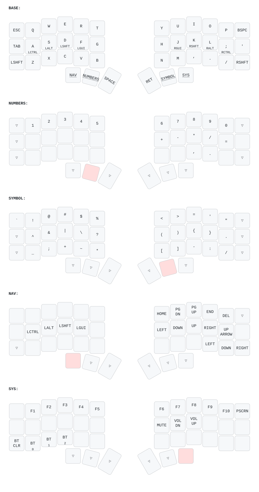

# Corne 3x6 - React/TypeScript Layout

> **Optimiert für React/TypeScript mit Aerospace Window Manager**
> Basierend auf Codebase-Analyse: 784 TS/TSX-Dateien



Gilt für beide Boards: Corne 3x6 (`config/corne.keymap`) und Corne Choc Pro
(`config/corne_choc_pro.keymap`, gleiche Belegung, Encoder-Positionen unbelegt).

## Warum dieses Layout?

Durch Analyse der Codebase wurden die häufigsten Sonderzeichen identifiziert:

| Zeichen | Vorkommen | Platzierung (SYM-Layer, QWERTY-Position) |
|---------|-----------|------------------------------------------|
| `.` | 20.468 | `;` (rechte Home Row) |
| `( )` | 16.415 | H / J (rechte Home Row) |
| `'` | 14.168 | O |
| `/` | 11.265 | `/` |
| `{ }` | 10.083 | K / L (rechte Home Row) |
| `:` | 8.195 | `.` |
| `=` | 8.159 | I |
| `-` | 7.823 | `,` |
| `< >` | 2.725 / 5.589 | Y / U |
| `_` | 2.482 | Z |
| `[ ]` | 1.106 | N / M |
| `;` | 12.628 (Prettier fügt es automatisch ein) | X |

**Resultat:** ~15-20% weniger Tastendrücke für React/TypeScript.

---

## Layout-Übersicht

### 6 Layer-System:
0. **BASE** - QWERTY mit Home Row Mods (Ctrl, Alt, Cmd)
1. **GAME** - BASE ohne Home Row Mods, für CS (Toggle: SYS + G)
2. **NUMBERS** - Zahlenreihe + Operatoren (L2 Daumen)
3. **SYMBOL** - React/TypeScript-optimiert (R2 Daumen)
4. **NAV** - Vim-Style Navigation + Modifier (L1 Daumen)
5. **SYSTEM** - F-Tasten, Lautstärke, Bluetooth (R3 Daumen)

### Layer-Zugriff:
- **L1 Daumen (outer-left)** → Nav Layer (momentary)
- **L2 Daumen (middle-left)** → Number Layer (momentary)
- **R2 Daumen (middle-right)** → Symbol Layer (momentary)
- **R3 Daumen (outer-right)** → System Layer (momentary)

In den Layer-Diagrammen bedeutet ein leeres Feld: ohne Funktion oder
transparent (die Taste aus BASE bleibt nutzbar, z. B. Tab, Shift, Backspace).
`███` markiert den gehaltenen Daumen.

---

## Layer 0: BASE

```
╭─────┬─────┬─────┬─────┬─────┬─────╮   ╭─────┬─────┬─────┬─────┬─────┬──────────╮
│ ESC │  Q  │  W  │  E  │  R  │  T  │   │  Y  │  U  │  I  │  O  │  P  │   BSP ⌫  │
├─────┼─────┼─────┼─────┼─────┼─────┤   ├─────┼─────┼─────┼─────┼─────┼──────────┤
│ TAB │  A  │  S  │  D  │  F  │  G  │   │  H  │  J  │  K  │  L  │  ;  │    '     │
│     │Ctl/A│Alt/S│     │Cmd/F│     │   │     │Cmd/J│     │Alt/L│Ctl/;│          │
├─────┼─────┼─────┼─────┼─────┼─────┤   ├─────┼─────┼─────┼─────┼─────┼──────────┤
│SHIFT│  Z  │  X  │  C  │  V  │  B  │   │  N  │  M  │  ,  │  .  │  /  │  SHIFT   │
╰─────┴─────┴─────┼─────┼─────┼─────┤   ├─────┼─────┼─────┼─────┴─────┴──────────╯
                  │ NAV │ NUM │ SPC │   │ RET │ SYM │ SYS │
                  ╰─────┴─────┴─────╯   ╰─────┴─────┴─────╯
```

### Home Row Mods (Hold):
- **Linke Hand:** A=Ctrl | S=Alt | F=Cmd
- **Rechte Hand:** J=Cmd | L=Alt | ;=Ctrl
- D und K haben keinen Modifier. Shift liegt nur auf den äußeren Shift-Tasten.

**Warum so?**
- Cmd auf Zeigefinger (F/J) — stärkster Finger für wichtigsten Modifier
- Alt auf Ringfinger (S/L) — für Aerospace Window Manager

### Mac und Windows gleich bedienen

Die Firmware sendet die Windows-Belegung: F/J = Ctrl, A/; = Win (GUI).
Damit sind die gewohnten Shortcuts auf beiden Systemen gleich, z. B. `F + T`
für einen neuen Tab (Mac: Cmd+T, Windows: Ctrl+T).

| Taste (Hold) | Firmware | macOS | Windows |
|--------------|----------|-------|---------|
| A / ;        | GUI      | Ctrl  | Win     |
| S / L        | Alt      | Alt   | Alt     |
| F / J        | Ctrl     | Cmd   | Ctrl    |

**Einmalig am Mac einrichten:** Systemeinstellungen → Tastatur →
Tastaturkurzbefehle… → Sondertasten → oben das Corne auswählen →
„Control (^)“ → „Befehlstaste (⌘)“ und „Befehlstaste (⌘)“ → „Control (^)“.
Das gilt nur für dieses Keyboard, die eingebaute Tastatur bleibt unverändert.

Nicht deckungsgleich ist die Textnavigation: Wortsprung ist am Mac
`Alt+←`, unter Windows `Ctrl+←` (`Alt+←` ist dort „Zurück“ im Browser).

---

## Layer 1: GAME (Counter-Strike)

Effektive Belegung, wenn GAME aktiv ist. `*` = anders als BASE.

```
╭─────┬─────┬─────┬─────┬─────┬─────╮   ╭─────┬─────┬─────┬─────┬─────┬──────────╮
│ ESC │  Q  │  W  │  E  │  R  │  T  │   │  Y  │  U  │  I  │  O  │  P  │   BSP ⌫  │
├─────┼─────┼─────┼─────┼─────┼─────┤   ├─────┼─────┼─────┼─────┼─────┼──────────┤
│ TAB │ *A  │ *S  │  D  │ *F  │  G  │   │  H  │ *J  │  K  │ *L  │ *;  │    '     │
├─────┼─────┼─────┼─────┼─────┼─────┤   ├─────┼─────┼─────┼─────┼─────┼──────────┤
│SHIFT│  Z  │  X  │  C  │  V  │  B  │   │  N  │  M  │  ,  │  .  │  /  │  SHIFT   │
╰─────┴─────┴─────┼─────┼─────┼─────┤   ├─────┼─────┼─────┼─────┴─────┴──────────╯
                  │*CTRL│ NUM │ SPC │   │ RET │ SYM │ SYS │
                  ╰─────┴─────┴─────╯   ╰─────┴─────┴─────╯
```

- **Keine Home Row Mods:** A S F / J L ; sind normale Tasten. Sonst wird
  langes Halten von A beim Strafen zu GUI (unter Windows: Win-Taste).
- **CTRL (Ducken)** statt NAV auf dem äußeren linken Daumen.
- NUM, SYM und SYS funktionieren wie gewohnt (GAME liegt direkt über BASE).

**Zugriff:** `SYS` halten → `G` (an/aus). Nach einem Neustart ist GAME aus.

---

## Layer 2: NUMBERS

```
╭─────┬─────┬─────┬─────┬─────┬─────╮   ╭─────┬─────┬─────┬─────┬─────┬─────╮
│     │  1  │  2  │  3  │  4  │  5  │   │  6  │  7  │  8  │  9  │  0  │     │
├─────┼─────┼─────┼─────┼─────┼─────┤   ├─────┼─────┼─────┼─────┼─────┼─────┤
│     │     │     │     │     │     │   │  +  │  -  │  *  │  /  │  =  │     │
├─────┼─────┼─────┼─────┼─────┼─────┤   ├─────┼─────┼─────┼─────┼─────┼─────┤
│     │     │     │     │     │     │   │     │     │  ,  │  .  │     │     │
╰─────┴─────┴─────┼─────┼─────┼─────┤   ├─────┼─────┼─────┼─────┴─────┴─────╯
                  │     │ ███ │     │   │     │     │     │
                  ╰─────┴─────┴─────╯   ╰─────┴─────┴─────╯
```

- Zahlenreihe 1-0 oben (wie die QWERTY-Zahlenreihe)
- Rechenoperatoren auf der rechten Home Row: `+` `-` `*` `/` `=`
- Dezimal: `,` `.`

**Zugriff:** L2 Daumen (middle-left) halten

---

## Layer 3: SYMBOL (React/TypeScript-optimiert)

```
╭─────┬─────┬─────┬─────┬─────┬─────╮   ╭─────┬─────┬─────┬─────┬─────┬─────╮
│  `  │  !  │  @  │  #  │  $  │  %  │   │  <  │  >  │  =  │  '  │  "  │     │
├─────┼─────┼─────┼─────┼─────┼─────┤   ├─────┼─────┼─────┼─────┼─────┼─────┤
│     │  ^  │  &  │  |  │  \  │  ?  │   │  (  │  )  │  {  │  }  │  .  │     │
├─────┼─────┼─────┼─────┼─────┼─────┤   ├─────┼─────┼─────┼─────┼─────┼─────┤
│     │  _  │  ;  │  +  │  ~  │  *  │   │  [  │  ]  │  -  │  :  │  /  │     │
╰─────┴─────┴─────┼─────┼─────┼─────┤   ├─────┼─────┼─────┼─────┴─────┴─────╯
                  │     │     │     │   │     │ ███ │     │
                  ╰─────┴─────┴─────╯   ╰─────┴─────┴─────╯
```

**Rechte Seite (SYM-Daumen rechts → Tipp-Hand rechts):**
- `( ) { } .` auf der Home Row — die häufigsten Zeichen, null Streckung
- `< > = ' "` auf der Top Row — `<>` benachbart (Roll)
- `[ ] - : /` auf der Bottom Row — `[]` benachbart (Roll)

**Linke Seite:**
- `` ` `` auf ESC — Template Literals
- `! @ # $ %` auf Q-T — gleiche Positionen wie 1-5 im NUM-Layer (Shift+1-5)
- `^ & | \ ?` auf der Home Row — Union Types, Pipe, Optional
- `_ ; + ~ *` auf der Bottom Row

**Rolls:** `<>` (Y+U), `=>` (U→I), `()` (H+J), `{}` (K+L), `[]` (N+M)

**Zugriff:** R2 Daumen (middle-right) halten

---

## Layer 4: NAVIGATION

```
╭─────┬─────┬─────┬─────┬─────┬─────╮   ╭─────┬─────┬─────┬─────┬─────┬─────╮
│     │     │     │     │     │     │   │HOME │PG_DN│PG_UP│ END │ DEL │     │
├─────┼─────┼─────┼─────┼─────┼─────┤   ├─────┼─────┼─────┼─────┼─────┼─────┤
│     │ CTL │ ALT │     │ CMD │     │   │  ←  │  ↓  │  ↑  │  →  │  ↑  │     │
├─────┼─────┼─────┼─────┼─────┼─────┤   ├─────┼─────┼─────┼─────┼─────┼─────┤
│     │     │     │     │     │     │   │     │     │     │  ←  │  ↓  │  →  │
╰─────┴─────┴─────┼─────┼─────┼─────┤   ├─────┼─────┼─────┼─────┴─────┴─────╯
                  │ ███ │     │     │   │     │     │     │
                  ╰─────┴─────┴─────╯   ╰─────┴─────┴─────╯
```

- **Vim-Style (Home Row rechts):** H=←, J=↓, K=↑, L=→
- **Pfeil-Cluster unten rechts:** `;`=↑, `.`=←, `/`=↓, Shift=→
- **Page-Navigation:** Home, PgDn, PgUp, End, Delete
- **Modifier links (A/S/F):** Ctrl | Alt | Cmd — kombinierbar mit Arrows
  (unter Windows: Win | Alt | Ctrl, siehe BASE)

**Modifier + Navigation Beispiele (macOS):**
- `NAV + F + →` → `Cmd+Right` (Zeilenende)
- `NAV + Shift links + ↓` → `Shift+Down` (Zeile markieren)
- `NAV + S + ←` → `Alt+Left` (Wortsprung links)
- `NAV + A + →` → `Ctrl+Right`

**Zugriff:** L1 Daumen (outer-left) halten

---

## Layer 5: SYSTEM

```
╭─────┬─────┬─────┬─────┬─────┬─────╮   ╭─────┬─────┬─────┬─────┬─────┬─────╮
│     │ F1  │ F2  │ F3  │ F4  │ F5  │   │ F6  │ F7  │ F8  │ F9  │ F10 │PSCRN│
├─────┼─────┼─────┼─────┼─────┼─────┤   ├─────┼─────┼─────┼─────┼─────┼─────┤
│     │     │     │     │     │GAME │   │MUTE │VOL- │VOL+ │     │     │     │
├─────┼─────┼─────┼─────┼─────┼─────┤   ├─────┼─────┼─────┼─────┼─────┼─────┤
│BTCLR│ BT0 │ BT1 │ BT2 │     │ OUT │   │     │     │     │     │     │     │
╰─────┴─────┴─────┼─────┼─────┼─────┤   ├─────┼─────┼─────┼─────┴─────┴─────╯
                  │     │     │     │   │     │     │ ███ │
                  ╰─────┴─────┴─────╯   ╰─────┴─────┴─────╯
```

- **F-Tasten:** F1-F10, Print Screen auf der Backspace-Position
- **Lautstärke:** Mute, Vol-, Vol+
- **Bluetooth:** Profil 0 (Z), Profil 1 (X), Profil 2 (C)
- **BTCLR:** löscht die Kopplung des gerade gewählten Profils
- **OUT (B):** schaltet zwischen USB und Bluetooth um (wird gespeichert)
- **GAME (G):** schaltet den GAME-Layer an/aus

**Zugriff:** R3 Daumen (outer-right) halten

**Beispiele:**
- Bluetooth wechseln: `SYS` halten → `X` (BT 1)
- Über Bluetooth tippen, obwohl das USB-Kabel steckt: `SYS` halten → `B`
- Lautstärke: `SYS` halten → `K` (Vol+)

**Neues Gerät koppeln:** `SYS` + freies Profil wählen (z. B. `C` für BT 2) →
`SYS` + Shift-Position (BTCLR) → am Gerät nach Bluetooth-Geräten suchen.

---

## Quick Reference

```
LAYER ACCESS:
━━━━━━━━━━━━━━━━━━━━━━━━━━━━━━━━━━━━━━━
L1 Daumen hold       → Nav Layer (momentary)
L2 Daumen hold       → Number Layer (momentary)
R2 Daumen hold       → Symbol Layer (momentary)
R3 Daumen hold       → System Layer (momentary)

HOME ROW MODS:
━━━━━━━━━━━━━━━━━━━━━━━━━━━━━━━━━━━━━━━
(macOS, Windows in Klammern)
A hold  → Ctrl (Win)   |  J hold  → Cmd (Ctrl)
S hold  → Alt          |  L hold  → Alt
F hold  → Cmd (Ctrl)   |  ; hold  → Ctrl (Win)
D, K    → kein Modifier, Shift nur außen

NAV LAYER MODIFIER (linke Hand):
━━━━━━━━━━━━━━━━━━━━━━━━━━━━━━━━━━━━━━━
A → Ctrl (Win)   S → Alt   F → Cmd (Ctrl)

SYSTEM (SYS halten):
━━━━━━━━━━━━━━━━━━━━━━━━━━━━━━━━━━━━━━━
Z/X/C → BT 0/1/2   Shift → BT löschen
B     → USB ⇄ Bluetooth
G     → GAME-Layer an/aus
```

---

## Ressourcen

- [ZMK Documentation](https://zmk.dev/docs)
- [Home Row Mods Guide](https://precondition.github.io/home-row-mods)
- [Corne Keyboard Wiki](https://github.com/foostan/crkbd)
